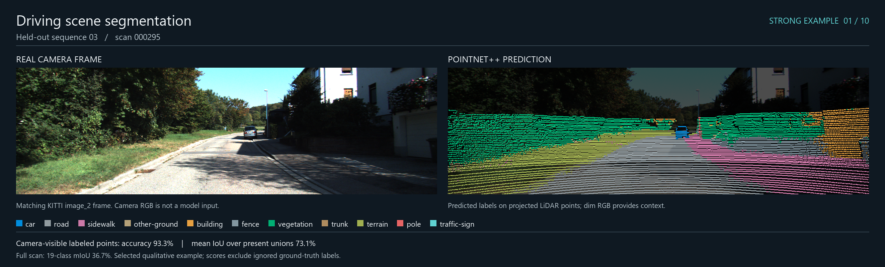
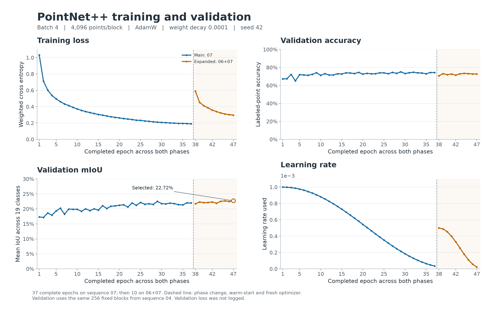

# DL project

## Understanding Driving Scenes with PointNet++

**Project creators: Sabuhi Aghayev and Ilkin Mammadli**

A university deep-learning project that implements, trains and evaluates a genuine
PointNet++ network for LiDAR road-scene semantic segmentation on SemanticKITTI.
The model receives XYZ coordinates and remission (laser return intensity) and
predicts one of 19 semantic categories for each point. Camera images are context
for the figures, not model inputs.



This is a **custom experimental split**, not an official benchmark submission.
The example above is selected after evaluation; it does not represent average performance.

## Final results

| Full-scene split | Scans | 19-class mIoU | Point accuracy | Car IoU | Road IoU |
|---|---:|---:|---:|---:|---:|
| Validation sequence 04 | 271 | 25.17% | 78.18% | 81.13% | 89.36% |
| Held-out sequence 03 | 801 | 33.36% | 75.01% | 89.22% | 82.48% |

Training: all 1,101 sequence-07 scans for 37 full epochs, followed by all 2,202
sequence-06/07 scans for 10 full epochs. The checkpoint was selected only with
the same 256 fixed validation blocks, then frozen before held-out inference.
That block-selection score (22.72%) differs from the full-scene scores above.
All 99,300,740 test scan points were inferred; ignored ground-truth labels are
excluded from scoring. mIoU19 includes all 19 classes with zero for zero union.

Rare classes remain weak: bicycle 2.98% IoU, person 2.27%, truck 0%.
The demo segment averages 5.46 seconds per scan, so inference is **not real time**.
Training used one RTX 4060 Laptop GPU. Recorded completed-epoch wall time was
43.43 hours; preparation, evaluation and repeated partial-epoch work add time.

## Read the report

- [Detailed report PDF](docs/PointNet2_Detailed_Report.pdf)
- [Editable Word report](docs/PointNet2_Detailed_Report.docx)
- [Single-file model and training script](PointNet2_SemanticKITTI.py)
- [Epoch-by-epoch training evidence](training_evidence/)
- [Final numerical metrics](results/)



Validation loss and training accuracy were not logged per epoch. No curves were
invented for them. The report explains the two phases and metric conventions.

## Architecture and settings

Four set-abstraction layers use 512 / 128 / 32 / 8 farthest-point centers,
0.8 / 1.6 / 3.2 / 6.4 m radii and up to 32 neighbors. Four feature-propagation
layers interpolate coarse features back to input points with skip connections.
The head outputs 19 logits per point. There are 969,395 trainable parameters.

| Setting | Value |
|---|---|
| Sample and batch | 4,096 points per spatial block; 4 blocks per batch |
| Inputs | XYZ and remission |
| Optimizer | AdamW; weight decay 0.0001 |
| Initial learning rate | 0.001 main; 0.0005 expanded |
| Schedule | Cosine decay; minimum 0.00001 |
| Objective | Class-weighted cross entropy; ignored target -1 |
| Precision | FP16 autocast/GradScaler; FP32 geometry |
| Seed | 42 |

## Setup

Original environment: Windows, Python 3.11.9, PyTorch 2.11.0+cu128 and CUDA 12.8.
Training requires an NVIDIA CUDA GPU and sufficient storage for multi-gigabyte
archives/caches. Other environments may require compatible PyTorch wheels;
exact bitwise reproducibility across hardware is not guaranteed.

```powershell
python -m venv .venv
& .venv/Scripts/python.exe -m pip install torch==2.11.0 --index-url https://download.pytorch.org/whl/cu128
& .venv/Scripts/python.exe -m pip install -r requirements.txt
& .venv/Scripts/python.exe PointNet2_SemanticKITTI.py --inspect-model
```

`--inspect-model` prints the architecture/configuration without training.
The single-file script was consolidated after the experiments and checked
against the original modular model with identical checkpoint outputs.

## Reproduce training from a fresh clone

The modular source below follows the original experiment. Downloads have pinned
SHA-256 checks. Use a fresh working directory; historical evidence under
`training_evidence/` must stay out of active source state.

```powershell
# Download and prepare sequences 07, 04 and 03.
& .venv/Scripts/python.exe source/pointnet2/download.py
& .venv/Scripts/python.exe source/pointnet2/prepare.py

# Separate diagnostic, then serious main training.
& .venv/Scripts/python.exe source/pointnet2/train.py --overfit
& .venv/Scripts/python.exe source/pointnet2/verify.py
& .venv/Scripts/python.exe source/pointnet2/train.py --config source/pointnet2/configs/main.json

# Additional data and expanded training from the main best weights.
& .venv/Scripts/python.exe source/pointnet2/download.py --extra06
& .venv/Scripts/python.exe source/pointnet2/prepare.py --extra06
& .venv/Scripts/python.exe source/pointnet2/train.py --config source/pointnet2/configs/expanded.json --warmstart source/pointnet2/runs/pointnet2_ssg_07/best.pt

# Freeze validation-only selection BEFORE inspecting held-out results.
& .venv/Scripts/python.exe tools/freeze_checkpoint.py
& .venv/Scripts/python.exe source/pointnet2/infer.py --checkpoint source/pointnet2/checkpoints/best.pt --split val
& .venv/Scripts/python.exe source/pointnet2/infer.py --checkpoint source/pointnet2/checkpoints/best.pt --split test
```

For an interrupted phase, run the same phase configuration with
`--resume source/pointnet2/runs/RUN_NAME/last.pt`. Resume restores the optimizer,
scheduler and completed epoch; warm-start loads only weights. Use the expanded
configuration when resuming expanded training. Fresh reproduction takes days.

The root single-file script is an alternative training entry point after data
preparation: `--data-root source/pointnet2 --phase main`. It saves under
`submission_runs/`, while the modular reproduction above saves under `runs/`.
Use one workflow consistently. The checkpoint-freezing helper above reads the
modular `runs/` workflow.

## Optional camera figures

After final inference, matching camera data can be downloaded separately with
`source/pointnet2/camera.py`. Then `source/pointnet2/visuals.py` renders calibrated
figures; `--video` needs FFmpeg. Camera downloads do not affect training.
The right panels are sparse projected LiDAR predictions, not dense RGB masks.

## Repository contents and limitations

Raw data, prepared cache arrays, model checkpoints and full prediction arrays
are excluded from Git. Reproduction generates them locally. Historical
selection records are evidence only; they do not freeze a newly trained run.

Training covers few routes. Geographic overlap involving the held-out route
remains unresolved; sequence separation alone does not prove independence.
Independent seeds, controlled baselines and systematic ablations are future work.
No live sensor integration or safety-critical deployment readiness is claimed.

## Attribution

PointNet++: Qi et al., NeurIPS 2017. SemanticKITTI: Behley et al., ICCV 2019.
KITTI: Geiger et al., CVPR 2012. Implementation adapted from
[yanx27/Pointnet_Pointnet2_pytorch](https://github.com/yanx27/Pointnet_Pointnet2_pytorch)
under MIT, pinned in `source/pointnet2/vendor/source.json`.
Dataset mirror: [SemanticKITTI-SP](https://huggingface.co/datasets/larryshaw0079/SemanticKITTI-SP).
See [third-party notices](THIRD_PARTY_NOTICES.md) for code/data/figure license boundaries.
